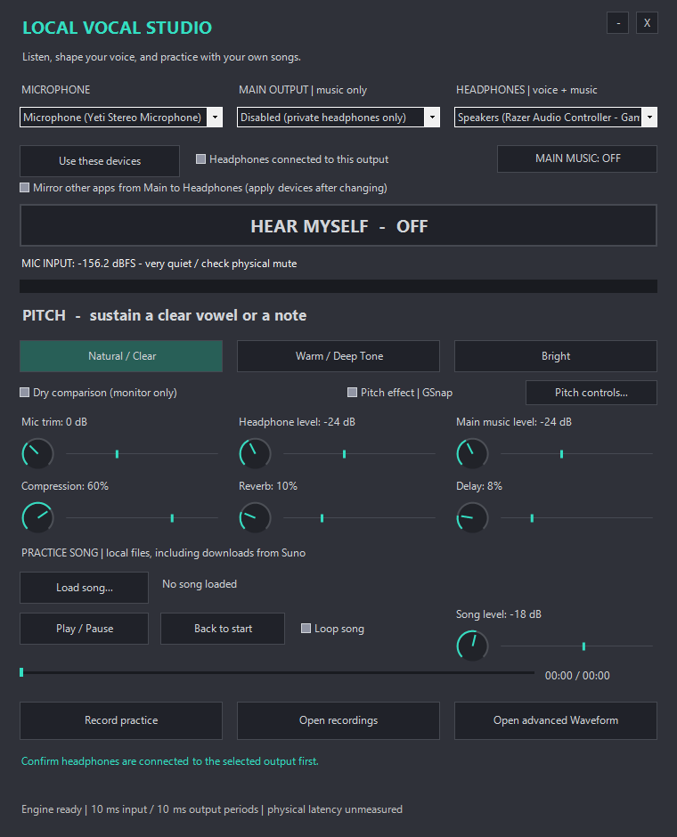

# Local Vocal Studio

A local Windows vocal-practice panel with private headphone monitoring, tone presets, recording, and your own backing songs. Original charcoal/teal controls follow the existing Waveform studio's visual style.

The screenshot predates the routing guard badge. Current builds show **NOT APPLIED / APPLYING / APPLIED / APPLY FAILED** above the routing buttons and label the button **APPLY ROUTING**.

## Start

1. Install **PowerShell 7 x64** using [Microsoft's instructions](https://learn.microsoft.com/powershell/scripting/install/installing-powershell-on-windows). Windows 10/11 and compatible audio endpoints are required.
2. Download this repository and run **Start-Studio.cmd**. Or run `pwsh -NoProfile -STA -File .\app\Listen.ps1` from its folder.
3. At the top, choose **Microphone** and **Headphones**. Leave **Main Output** disabled for private practice. Click **APPLY ROUTING** and wait for **APPLIED**.
4. Confirm headphones are connected to that output. Click **Hear Myself**. Listening starts OFF and at **-24 dB** on every launch; raise the headphone level gradually.
5. Choose **Natural / Clear**, **Warm / Deep Tone**, or **Bright**. **Dry comparison** bypasses effects in headphones while preserving the processed recording.
6. **Load song** opens a local file, including a song you downloaded from Suno. Use Play/Pause, Loop, seek, and Song level.
7. **Record practice** saves separate 24-bit/48 kHz stereo **DRY** and **FX** vocal WAVs under `recordings/`. Click **Stop recording** to finish. Songs and mirrored audio are excluded from both takes.

Your microphone is processed on this PC. The panel does not make calls, transmit audio, train voice models, change Windows defaults, or install drivers.

## Output choices and privacy

| Control | What it carries |
| --- | --- |
| Headphones | Your voice plus the app song, or the selected Main endpoint's mirrored audio |
| Main Output | This app's song only; the microphone never enters this bus |
| Headphone level | Private voice/music listening volume |
| Main music level | This app's song level on Main; other apps retain their own volume |
| Song level | Backing song balance before its output levels |
| Main Music ON/OFF | Enables this app's song on the selected Main output |

For two outputs, choose different **Main Output** and **Headphones**, then Apply. Main music and headphone listening both start OFF. Enable Main Music when you want the loaded song there.

**Mirror other apps from Main to Headphones** uses Windows loopback on the selected Main endpoint. Select it and apply devices. Other apps must already play to Main, or be assigned there in Windows' volume mixer. It does **not** automatically duplicate every app or every Windows output. When mirroring, the loaded song reaches headphones through Main rather than being mixed twice; enable Main Music for that song. Mirroring never feeds the Main output or an outgoing microphone bus.

Main and Headphones cannot be the same endpoint. Changing any microphone, Main, headphone or mirror choice immediately mutes both outputs, clears headphone confirmation and marks the route **NOT APPLIED**. Hear Myself, Main Music and headphone confirmation are disabled until the displayed choices have actually initialized successfully. The click handlers independently check the applied route, so re-checking headphones or forcing a click cannot resume an older route. Failed or timed-out Apply stays locked; it does not authorize the previous route. Reapplying also leaves both outputs OFF and requires fresh headphone confirmation.

Apply recreates the panel's streams, so reload the song afterward. During an active recording, Stop Recording remains available and Apply is disabled; a selection change mutes monitoring but does not discard that recording. Saved choices may initialize on startup, but output enabling stays locked until initialization succeeds. After updating the source, close/reopen the panel when you are ready to activate the repair; an already running session is not hot-patched or restarted.

Independent output clocks are not sample synchronized. Audible dual-output/system mirroring remains unverified on the test machine.

## Voice controls

- **Mic trim:** software gain before effects. DRY keeps the original input level.
- **Tone presets:** broad low/high EQ plus a 65 Hz high-pass filter. Warm changes timbre; it does not lower vocal pitch.
- **Compression:** controls gain reduction above -18 dBFS.
- **Reverb / Delay:** simple room tail and 300 ms echo. Zero removes the audible effect.
- **Input pitch display:** an estimate for sustained monophonic notes; speech/noise and complex sounds can confuse it.
- **Pitch effect / Pitch controls:** optional GSnap correction with key, chromatic/major/natural-minor scale, amount, attack and release; Natural and Hard Tune presets. Values save locally.

## What is included, and separate downloads

This repository contains **original panel/audio-engine source, original control presets, tests and documentation**. It does not bundle Waveform, GVST, Graillon, FFmpeg, installers, drivers, recordings, accounts or third-party preset packs. The MIT license covers only this repository's original work.

| Optional dependency | Purpose and account/license requirements |
| --- | --- |
| [Waveform Free](https://www.tracktion.com/products/waveform-free) | Advanced DAW with detailed EQ, dynamics, reverb/delay and VST plugin windows. A [free Tracktion account](https://www.tracktion.com/register) installs/unlocks Free; a paid Pro plan is optional. Not required by the simple panel. |
| [GVST GSnap](https://gvst.uk/Downloads/GSnap) | Pitch correction. Download separately and accept GVST's license. Put your licensed 64-bit `GSnap.dll` in `plugins/GVST/` under this folder. No account or paid plan is required for GSnap. |
| [GVST GTune](https://gvst.uk/Downloads/GTune) | Optional detailed tuner in Waveform; separate GVST license. The panel has its own basic input-pitch estimate. |
| [FFmpeg](https://ffmpeg.org/download.html) | Optional local conversion for MP3, FLAC, M4A and nonmatching WAV formats. Install separately and expose `ffmpeg.exe` on PATH. No account. Binary licenses depend on the build. Native panel playback accepts 48 kHz stereo PCM/float WAV. |
| [Suno](https://suno.com/) | Optional source of songs you create/download through your own account and applicable plan. Load the downloaded file. No Suno account is used by this panel; there is no Suno API/cloud integration. |

### Pitch-correction limits

Installed/tested integration: **GSnap 3.1.0**, a monophonic pitch corrector. Its [official manual](https://gvst.uk/Downloads/GSnap) describes scale notes, amount and attack/release. It has **no formant-shift control, dedicated humanization control or automatic song-key detection**. MIDI-guided correction exists in GSnap's DAW workflow; this panel does not send MIDI to it. The integration is not a complete professional pitch-editing suite.

[Graillon 3.2](https://www.auburnsounds.com/products/Graillon.html) is an additional option with formant controls, pitch shifting, natural/hard correction and transition controls. Its [manual](https://www.auburnsounds.com/downloads/Graillon%203%20User%27s%20Guide.pdf) identifies further Full-edition features. It is **not installed or integrated here**; accepting its separate EULA is required before installation. Antares Auto-Tune products require their own separately obtained licenses and are not included.

## Audio requirements and latency

Current engine support is deliberately narrow: each selected endpoint must expose an existing **48 kHz, stereo, 32-bit float Windows shared mix format**. Tested with a USB Yeti input and Razer Game output. Unsupported/removed devices stop the engine with a visible error; the app does not fall back to speakers or alter formats.

The reliable tested configuration used **480-frame/10 ms input and output periods**. These are scheduling periods, **not measured physical round-trip latency**. A capture-queue/output-padding estimate was about 23 ms in the synthetic test. GSnap reports **481 samples (~10 ms at 48 kHz)** of additional plugin delay. USB transport, hardware, Windows buffering, scheduling and effects add latency. Zero latency is not promised.

Yeti jack direct monitoring is **dry hardware monitoring**, separate from software effects. If both paths are heard together, use a single monitoring path; the panel does not disable the Yeti's hardware direct signal. Keep Waveform/OBS input monitoring OFF while using this panel's voice monitor.

## Verification

Passed: offline tone presets/finite audio, A440 estimate (439.998 Hz), installed GSnap synthetic processing, synthetic DRY/FX recording (matching 2.01-second 24-bit/48 kHz files with different contents), song load/play/pause/seek/rewind, startup silence, invalid-device failure handling and clean stop. The muted stream test had zero output starvation events and one initial capture discontinuity flag. MP3 conversion was tested with a locally generated file.

Actual headphone audibility, physical latency, long recording sessions, audible dual-output/system mirroring and real calls remain **untested**. The physical headphone connection was not confirmed during setup. View [test scope](docs/TESTING.md) before relying on the routing in a live session.

Run the device-free synthetic checks with `pwsh -NoProfile -File .\tests\Test-Core.ps1`. Nothing is played or recorded from a microphone by that test.

Run `pwsh -NoProfile -File .\tests\Test-RouteGuard.ps1` for the routing regression checks. They execute the production controller, UI functions and output/Apply callbacks using fake controls and fake engines. They cover selector changes, forced re-enable attempts, initialization/validation/stream-close failures, timeouts, repeated Apply, stale completions and startup. No audio devices or running user session are touched; physical listening remains untested.

## Calls and restore

The simple panel defaults to private headphones. For optional per-app virtual-mic routing, see [advanced workflow](docs/ADVANCED.md). Never send a Main/music loopback mix to a call microphone. Keep call return on headphones and out of the outgoing voice bus.

To bypass: turn **Hear Myself** and **Main Music** OFF, or close the panel. Clear Mirror and apply to stop loopback use. Windows defaults remain as they were. Local endpoint selections are in `app/devices.local.json`; deleting that file resets only panel choices. Recordings stay local. No startup service or background automation is installed.
